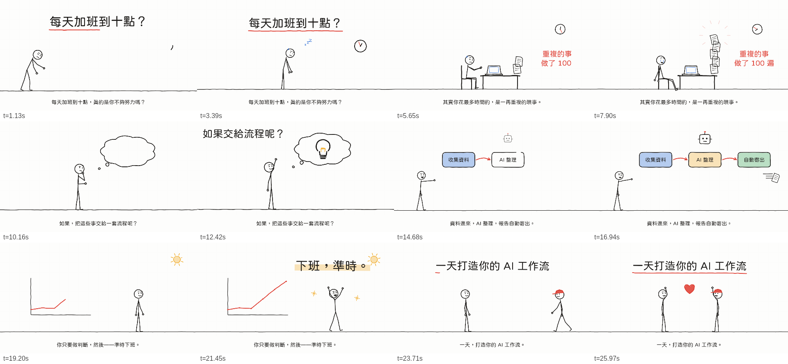

# Stickman Code Video

[中文](README.md)

An Agent Skill (Claude, Antigravity, Codex…) that turns a topic or script into a **hand-drawn line-art stickman animation**. Every frame is drawn by code — no image or video generation service involved.



## Features

- **Rigged stickman**: joint angles + forward kinematics, 28 built-in poses, 15 expressions, smooth blending between keyframes
- **Procedural actions**: walk/run (foot-locked gait from real displacement), talk, wave, jump, type, tremble, dance…
- **One hand-drawn line language**: every stroke is jittered and "boils", and can be drawn on stroke by stroke — props, arrows, bubbles and charts included
- **35 line icons** plus SVG paths for anything else
- **Camera & transitions**: pan/zoom, shake, wipe / fade / iris
- **Output**: MP4 (with narration/SFX mix), contact sheets, single-file HTML preview player
- Bundled jf open-huninn font for Traditional Chinese

## Quick start

```bash
npm install
npm run demo                 # → demo.mp4
npm run preview              # → examples/preview.html (open in a browser)
```

Drop the folder containing `SKILL.md` into your agent's skills directory and ask: "Use stickman-code-video to turn this article into a 30-second animation."

## Docs for the agent

- [`SKILL.md`](SKILL.md) — workflow (Traditional Chinese)
- [`references/scene-format.md`](references/scene-format.md) — scene JSON spec
- [`references/directing.md`](references/directing.md) — directing method & acceptance checklist
- [`references/poses.png`](references/poses.png), [`faces.png`](references/faces.png) — pose / face catalogue

Angle convention: degrees, `0` = straight down, positive = toward the facing direction. `arm: [shoulder, elbow]`, `leg: [hip, knee]`.

## Credits

Directing principles adapted from [kaomei/stickman-video-director](https://github.com/kaomei/stickman-video-director) (MIT). Font: [jf open-huninn](https://github.com/justfont/open-huninn-font) (OFL 1.1).
