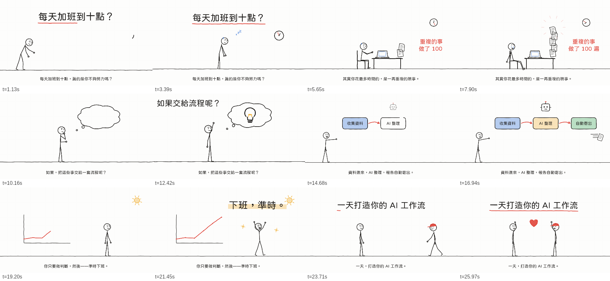

# Stickman Code Video · 純程式線條火柴人動畫

[English](README.en.md)

一個給 AI Agent（Claude、Antigravity、Codex…）使用的 Skill：把主題或腳本變成**手繪線條風格的火柴人動畫**，所有畫面都由程式碼即時繪製，不需要任何圖片或影片生成服務。



## 特色

- **骨架式火柴人**：關節角度 + 前向運動學，28 種內建姿勢、15 種表情，關鍵影格間自動平滑混合
- **程序化動作**：走路／跑步（依位移算步伐，腳不打滑）、說話、揮手、跳、打字、發抖、跳舞…
- **手繪線條語言**：所有線條都有抖動與「沸騰」效果，可逐筆畫出；道具、箭頭、對話框、圖表都是線條
- **35 種線條圖示**，加上 SVG path 可畫任何東西
- **鏡頭與轉場**：推拉、震動、wipe / fade / iris
- **輸出**：MP4（含旁白／音效混音）、分鏡總覽圖、單檔 HTML 預覽播放器
- 內附 jf open 粉圓字型，繁體中文開箱即用

## 快速開始

```bash
npm install
npm run demo                 # → demo.mp4
npm run preview              # → examples/preview.html（瀏覽器打開即可播放）
```

把 `SKILL.md` 所在資料夾放進你的 Agent skills 目錄，然後說：「用 stickman-code-video 幫我把這篇文章做成 30 秒動畫」。

## 給 Agent 讀的文件

- [`SKILL.md`](SKILL.md)：工作流程
- [`references/scene-format.md`](references/scene-format.md)：場景 JSON 規格
- [`references/directing.md`](references/directing.md)：導演方法與驗收清單
- [`references/poses.png`](references/poses.png)、[`faces.png`](references/faces.png)：姿勢／表情目錄

## 致謝

導演原則改寫自 [kaomei/stickman-video-director](https://github.com/kaomei/stickman-video-director)（MIT）。字型：[jf open 粉圓](https://github.com/justfont/open-huninn-font)（OFL 1.1）。
